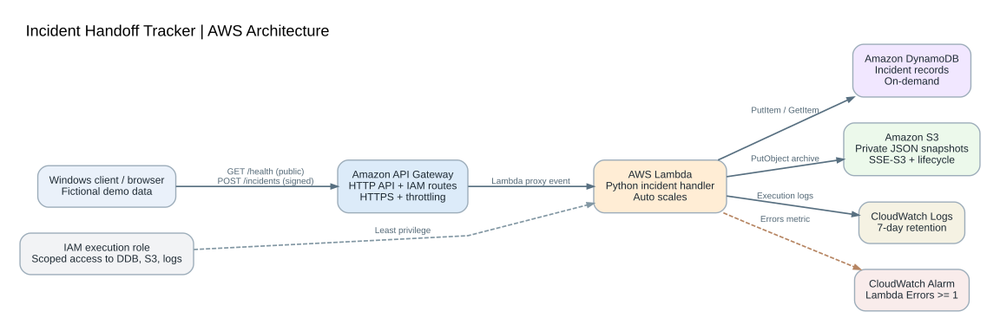

# Incident Handoff Tracker — AWS Architecture Portfolio

**Author:** Jacinto Jimenez · **Course:** CS 79C · **Region:** `us-west-2` (Oregon)  
**Status:** **Deployed and tested in AWS October 27, 2026.** Live evidence recorded. **Teardown not yet verified.**

A minimal serverless incident-tracking API that accepts and retrieves **fictional** technical-support incidents and archives one JSON snapshot per record. It demonstrates a five-service AWS architecture, reproducible CloudFormation infrastructure, scoped IAM roles, monitoring, and transparent cost/reliability trade-offs. **Do not submit real employees', customers', tickets', secrets, or proprietary data.**



## Verified deployment results (AWS evidence)

| Checkpoint | Observed result | Evidence |
|---|---|---|
| CloudFormation | Stack `incident-handoff-portfolio` reached `CREATE_COMPLETE`. | [Stack screenshot](evidence/01-cloudformation-create-complete.png) |
| Public HTTP API | `/health` returned `status: ok`, region, project and author. | [Live API response](evidence/02-public-health-url.png) |
| Create incident | Lambda console test returned `statusCode: 201` for `Demo conveyor alert`. | [Lambda POST test](evidence/03-lambda-create-201.png) |
| Data storage | DynamoDB scan returned the recorded incident with severity MEDIUM. | [DynamoDB item](evidence/04-dynamodb-item.png) |
| JSON snapshot | Private S3 archive contained `incidents/ec99fa8c-95c3-4c42-8670-a061fc7a4cb6.json`. | [S3 object](evidence/05-s3-archive.png) |
| Retrieve incident | Lambda console GET test returned `statusCode: 200` and the matching incident. | [Lambda GET test](evidence/06-lambda-get-200.png) |
| Observability | CloudWatch logged START, END and REPORT and the error alarm was OK. | [Execution logs](evidence/07-cloudwatch-logs.png), [alarm](evidence/08-cloudwatch-alarm.png) |
| Cost estimate | AWS Pricing Calculator: **$0.46/month**, **$5.52/year** across five services. | [Cost breakdown](evidence/09-pricing-calculator.png) |

**Test boundaries:** The public `/health` request traversed API Gateway and Lambda. The incident POST/GET proofs were direct **Lambda console events**, not end-to-end IAM-signed HTTP requests. The provided `scripts/test_api.py` supports SigV4 testing from a correctly authorized local AWS session; such a test is recommended before final submission but **not claimed as complete** here. No load test, recovery exercise, or confirmed teardown is shown.

## Architecture and service-selection rationale

| AWS service | What it does | Why selected over the alternative |
|---|---|---|
| **API Gateway HTTP API** | Hosts HTTPS routes and enforces IAM authentication on incident paths | Simpler and avoids always-on ALB cost for a small API |
| **AWS Lambda (Python 3.12, arm64)** | Validates requests; writes to DynamoDB and S3; handles reads | Avoids provisioning, maintaining, or paying for an idle EC2 server |
| **DynamoDB On-Demand** | Primary incident records indexed by `incidentId` | More suitable than maintaining an RDS instance for low-volume key-value lookups |
| **Amazon S3 Standard** | Private encrypted JSON snapshots in `incidents/` | Better archive object storage than filesystem snapshots on EC2 |
| **CloudWatch Logs + Alarm** | Records invocations; monitors Lambda Errors ≥ 1 per 5 minutes | Native monitoring without administering a separate metrics server |
| **IAM** | Grants the handler table/object/log permissions without access keys | Safer than credentials embedded in source code |
| **CloudFormation** | Declares the integrated stack in `template.yaml` | Direct AWS-managed IaC for this project instead of Terraform provider setup |

**Data flow:** Browser → public `GET /health` → API Gateway → Lambda. For fictional incident read/write routes, an IAM-signed client → API Gateway → Lambda → DynamoDB (records) and S3 (POST archive). Lambda events are sent to CloudWatch Logs and the Errors metric feeds an alarm. The application uses no EC2, ALB, NAT gateway, or user-managed security group.

## Deploy, test, and reproduce

Requirements: AWS account permitted to create IAM roles, Lambda, API Gateway, DynamoDB, S3 and CloudWatch; use region `us-west-2`. 

1. In the AWS CloudFormation console choose **Create stack → With new resources (standard)** and upload `template.yaml`.
2. Name the stack `incident-handoff-portfolio`, use `StudentName = Jacinto Jimenez`, retain rollback and acknowledge IAM resource creation.
3. Verify `CREATE_COMPLETE`. In **Outputs**, open `HealthURL` and confirm a JSON status of `ok` with student name.
4. For backend testing, use the sample events in [the deployment guide](docs/DEPLOY_GUIDE.md); record `statusCode: 201`, then `200`, and verify the matching DynamoDB item and S3 `incidents/<uuid>.json` object.
5. Optionally test IAM-protected HTTP routes with a **separately authorized** AWS session (permission `execute-api:Invoke`):

```powershell
py -m pip install boto3 botocore
py scripts/test_api.py --url "https://YOUR_API_ID.execute-api.us-west-2.amazonaws.com" --region us-west-2
```

This script requires valid local AWS credentials; **do not commit credential files**. An unsigned incident POST/GET is intentionally forbidden. The public health endpoint remains accessible without authentication.

```powershell
py -m unittest discover -s tests -v
```

The separate local tests use mocked AWS clients and are not substitutes for the live evidence above.

## Security, reliability, performance, and cost

- **Security:** IAM authorization on incident routes, least-privilege Lambda role (DynamoDB PutItem/GetItem, S3 PutObject only in the incident prefix, logging), encrypted HTTPS, DynamoDB at-rest encryption, S3 SSE-S3 and blocked public bucket access. The demo has no Cognito identity/tenant isolation, WAF, or real-data policy enforcement: never put sensitive content in it.
- **Reliability:** Regional managed services remove a single user-maintained server but the solution still relies on one AWS Region. No demonstrated cross-Region DR, DynamoDB PITR, or restore test. **Proposed** RTO = 4 hours and RPO = 1 hour are **unverified design goals**, not guarantees. A failed S3 upload after a successful DynamoDB write can leave an unarchived record.
- **Performance:** Lambda and DynamoDB operate on demand. API stage rate limit 2 requests/s, burst 5. Two observed Lambda direct test executions took **3091.98 ms (POST)** and **2416.57 ms (GET)**; these are individual runs, not p95 latency. Synchronous S3 archiving, cold starts and throttling are trade-offs; no load test has been run.
- **Cost:** Under the **hypothetical** AWS Pricing Calculator workload (10,000 HTTP requests and Lambda calls/month; 5,000 DynamoDB reads and writes; 1 GB DynamoDB storage; 1 GB S3 and 5,000 PUT/GET; 0.1 GB logs; one alarm), estimated charge is **$0.46/month ($5.52/year)**: API $0.01, Lambda $0.00 (free-tier assumption), DynamoDB $0.25, S3 $0.05, CloudWatch $0.15. This is **not an invoice** and excludes unmodeled account traffic. The calculator was entered with **x86 Lambda** while the deployed template specifies **arm64**; reselect arm64 before using the estimate as a precise architecture comparison. Cost optimizations: no always-on EC2/ALB/NAT, pay-per-request DynamoDB, 128 MB Lambda and seven-day retention.

## Well-Architected self-review

| Pillar | Strength | Limitation / planned improvement |
|---|---|---|
| Security | IAM-signed incident routes, scoped service role, private encrypted S3 | Add user authentication, WAF and security tests |
| Reliability | Managed AWS services and independent S3 JSON snapshots | Add asynchronous archive retries, DynamoDB PITR and recovery testing |
| Cost Optimization | Serverless idle-cost avoidance; on-demand database; short retention | Compare arm64 calculator assumptions, set budgets, optimize log/alarm costs |

## Project layout

- `template.yaml` — single CloudFormation deployment file (inline Lambda implementation)
- `infra/template.base.yaml` — source infrastructure template
- `src/handler.py` — readable Lambda source
- `scripts/build_template.py` — inlines handler into deployable template
- `scripts/test_api.py` — optional SigV4 end-to-end HTTP test (requires authorized credentials)
- `tests/` — offline handler tests
- `diagram/architecture.svg` and `.png` — architecture graphic
- `evidence/` — live AWS screen captures listed above
- `docs/` — reproducible deployment guide and portfolio report

## Cleanup status and cost control

**Cleanup not verified as of the captured evidence.** After any further testing, download/save screenshots, empty the project's S3 bucket (and delete object versions, if any), then delete `incident-handoff-portfolio` using CloudFormation. Confirm stack deletion and check the project S3 bucket, DynamoDB table, Lambda handler, and CloudWatch log group no longer exist. Remove any separate older course stacks when no longer needed. **Do not claim the stack is deleted until AWS confirms it.**

## Official references

- [AWS Well-Architected Framework](https://docs.aws.amazon.com/wellarchitected/latest/framework/welcome.html)
- [AWS CloudFormation templates](https://docs.aws.amazon.com/AWSCloudFormation/latest/UserGuide/template-guide.html)
- [IAM authentication for HTTP APIs](https://docs.aws.amazon.com/apigateway/latest/developerguide/http-api-access-control-iam.html)
- [AWS Lambda pricing](https://aws.amazon.com/lambda/pricing/)
- [AWS Pricing Calculator](https://calculator.aws/)
